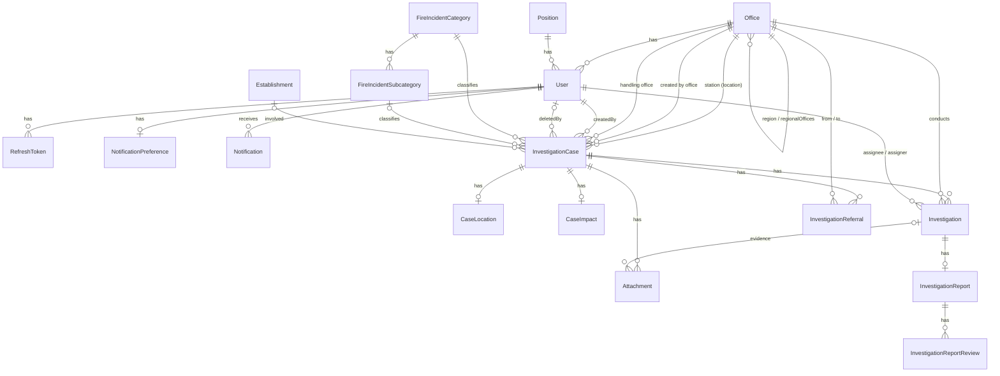

# FIIS Data Model

PostgreSQL through Prisma 7. The schema is split: `backend/prisma/schema.prisma` holds the generator and datasource, and `backend/prisma/models/**/*.prisma` holds the models. The client is generated into `backend/src/generated/prisma/`. Migrations are in `backend/prisma/migrations/`. See [ARCHITECTURE.md](ARCHITECTURE.md) for how the code uses these tables.

## 1. Entity relationships

`IncidentNumberCounter` (table `incident_number_counters`) stands alone. `AuditLog` references only its actor (`User`); its `officeId`, `regionId` and `entityId` are plain snapshot ids (§5).

## 2. Organization and users

| Model | Key fields | Constraints |
|---|---|---|
| `Office` | `name`, `type: OfficeType`, `isActive`, `parentId?`, `regionId?`, `regionCode?` | `@@unique([parentId, name])`; `regionCode` unique; indexes on `parentId`, `regionId`, `type` |
| `User` | `email`, `account_number`, `rank: RANK`, names, `password` (bcrypt hash), `isActive`, `mustChangePassword`, `failedLoginCount`, `lockedUntil`, `officeId`, `positionId`, `role: ROLE` | `email` and `account_number` unique; indexes on `officeId`, `positionId`, `role` |
| `Position` | `name`, `isActive` | `name` unique |
| `RefreshToken` | `refreshToken` (SHA-256 hash of the token), `expiresAt`, `userId` | unique; cascade on user delete |
| `NotificationPreference` | `investigationUpdates`, `reportReview`, `systemAnnouncements` (all default on) | one per user; cascade |
| `Notification` | `userId`, `type: NotificationType`, `title`, `body`, `entityType: NotificationEntityType`, `entityId`, `readAt?`, `createdAt` | in-app inbox (Q-21); cascade with the user; index `(userId, readAt, createdAt)` |

- `Office` has two self-relations. `parent`/`children` is the hierarchy, and `region`/`regionalOffices` points every office at its regional office. Only regional offices carry a `regionCode`, which case numbers use.
- `password` must never leave the API.

## 3. Investigation cases

Fire incidents were removed in REQUIREMENTS.md revision 13. The case fields are provisional until the official BFP forms are available.

| Model | Key fields | Notes |
|---|---|---|
| `InvestigationCase` | `caseNo`, date fields (`dateTimeFireIncident`, `dateTimeReported`, `dateTimeCallReceived`; all optional), `stationId`, `createdByOfficeId`, `handlingOfficeId`, `createdById`, `categoryId`, `subcategoryId?`, `establishmentId?`, `remarks?`, `deletedAt?`, `deletedById?`, `deletionReason?`, `deletionMemoReference?` | `caseNo` (`INV-YYYY-MM-<REGIONCODE>-NNNNNN`) is unique and generated on creation. `stationId` is the city/municipal station where the fire happened; the referral chain runs from it. Indexed on station, creating office, handling office, category, subcategory, establishment, `dateTimeFireIncident`, `deletedAt`. |
| `CaseLocation` | `placeOfOccurence`, `barangay`, `region`, `province_district`, `city_municipality`, `latitude?`, `longitude?` (`Decimal(9,6)`) | 1:1, cascade. Region, province/district and city/municipality are derived from the station. |
| `CaseImpact` | civilian, BFP and LEA fatalities and injuries, `establishmentsBurned`, `familiesAffected`, `individualsAffected`, `estimatedDamages?`, `finalEstimatedDamages?` (`Decimal(15,2)`) | 1:1, cascade |
| `FireIncidentCategory` | `name`, `type: CATEGORY_TYPE` | `name` unique (model name kept) |
| `FireIncidentSubcategory` | `name`, `categoryId` | `@@unique([categoryId, name])`; cascade from category |
| `Establishment` | `binBanNumber?`, `name`, `ownerName?`, `occupantName?`, `totalLotFloorArea?`, `contentStorage?`, `numberOfStoreys?` | `binBanNumber` unique |
| `IncidentNumberCounter` | `year`, `month`, `regionCode`, `lastNumber` | table `incident_number_counters` (name kept); `@@unique([year, month, regionCode])`; incremented by upsert inside the case-creation transaction |

## 4. Investigations

| Model | Key fields | Notes |
|---|---|---|
| `Investigation` | `investigationNo` (`<caseNo>-<NN>`), `causeOfFire?`, `classification?`, `originOfFire?`, `startedAt`, `completedAt?`, `caseId`, `conductingOfficeId`, `assignedInvestigatorId`, `assignedById` | `investigationNo` unique. Many per case; at most one open (`completedAt` null) is enforced under a row lock on the case. Indexes on case, conducting office, assignee. |
| `InvestigationReport` | `findings?`, `cause?`, `conclusion?`, `recommendations?`, `status: ReportStatus`, `submittedAt?`, `reviewedAt?`, `reviewedById?` | 1:1 with investigation; cascade |
| `InvestigationReportReview` | `decision: ReportDecision`, `reviewerId`, `remarks?`, `createdAt` | review history; index `(reportId, createdAt)` |
| `InvestigationReferral` | `fromOfficeId`, `toOfficeId`, `direction: ReferralDirection`, `referredById`, `remarks?`, `createdAt` | referral history per case; index `(caseId, createdAt)` |

Investigation fields (cause, classification, origin) are kept on each investigation, separate from the case fields.

## 5. Attachments

| Model | Key fields | Notes |
|---|---|---|
| `Attachment` | `caseId`, `investigationId?`, `uploadedById`, `originalName`, `mimeType` (detected from content), `sizeBytes`, `storageKey` (unique, never returned to clients), `sha256`, `description?`, `createdAt`, `removedAt?`, `removedById?` | Q-22. Cascades with its case or investigation; soft removal by the uploader. Index `(caseId, createdAt)`, `investigationId`. |

## 5a. Audit log

| Model | Key fields | Notes |
|---|---|---|
| `AuditLog` | `actorId → User`, `action: AuditAction`, `entityType: AuditEntityType`, `entityId`, `officeId?`, `regionId?`, `changes Json?`, `createdAt` | Written in the same transaction as the change. `officeId`/`regionId` are snapshots for `REGIONAL_ADMIN` scoping, so entries outlive deleted offices. `changes` holds `{ field: { from, to } }` for updates or a field snapshot for creates and deletes, never passwords or tokens. Indexes on `(entityType, entityId)`, `actorId`, `createdAt`, `officeId`, `regionId`. |

## 6. Enums

| Enum | Values |
|---|---|
| `OfficeType` | `NATIONAL_HEADQUARTERS`, `REGIONAL_OFFICE`, `DISTRICT_FIRE_STATION`, `PROVINCIAL_FIRE_STATION`, `CITY_FIRE_STATION`, `MUNICIPAL_FIRE_STATION` |
| `ROLE` | `SUPER_ADMIN`; NHQ: `NHQ_ADMIN`, `NHQ_VIEWER`, `NHQ_CHIEF_INVESTIGATOR`, `NHQ_INVESTIGATOR`; Regional: `REGIONAL_ADMIN`, `REGIONAL_CHIEF_INVESTIGATOR`, `REGIONAL_INVESTIGATOR`, `REGIONAL_VIEWER`; District/Provincial: `DISTRICT_PROVINCE_CHIEF_INVESTIGATOR`, `DISTRICT_PROVINCE_INVESTIGATOR`, `DISTRICT_PROVINCE_VIEWER`; City/Municipal: `CITY_MUNICIPALITY_INVESTIGATOR`, `CITY_MUNICIPALITY_CHIEF_INVESTIGATOR` |
| `RANK` | `SFO4`, `SFO3`, `SFO2`, `SFO1`, `FO3`, `FO2`, `FO1` |
| `CATEGORY_TYPE` | `STRUCTURAL`, `NON_STRUCTURAL`, `TRANSPORTATION`, `WILDLAND` |
| `ReferralDirection` | `UP`, `DOWN` |
| `ReportStatus` | `DRAFT`, `SUBMITTED`, `UNDER_REVIEW`, `APPROVED`, `REJECTED` |
| `ReportDecision` | `UNDER_REVIEW`, `APPROVED`, `REJECTED` |
| `FireCaseClassification` | `UNDER_INVESTIGATION`, `ACCIDENTAL`, `INCENDIARY_INTENTIONAL`, `NATURAL`, `FIRE_CASE_WITH_NEGLIGENT_ACTS` |
| `AuditAction` | `USER_CREATED`, `USER_UPDATED`, `USER_ACTIVATED`, `USER_DEACTIVATED`, `USER_PASSWORD_CHANGED`, `OFFICE_CREATED/UPDATED/DELETED`, `POSITION_CREATED/UPDATED/DELETED`, `CATEGORY_CREATED/UPDATED/DELETED`, `SUBCATEGORY_CREATED/UPDATED/DELETED`, `CASE_DELETED`, `CASE_RESTORED`, `ATTACHMENT_DOWNLOADED` |
| `NotificationType` | `CASE_REFERRED`, `INVESTIGATOR_ASSIGNED`, `REPORT_SUBMITTED`, `REPORT_APPROVED`, `REPORT_REJECTED` |
| `NotificationEntityType` | `INVESTIGATION_CASE`, `INVESTIGATION` |
| `AuditEntityType` | `USER`, `OFFICE`, `POSITION`, `FIRE_INCIDENT_CATEGORY`, `FIRE_INCIDENT_SUBCATEGORY`, `INVESTIGATION_CASE`, `ATTACHMENT` |
| `CauseOfFire` | about 40 values, including `UNDER_INVESTIGATION`; see `models/Investigation/enums.prisma` |

Known misspellings that are deferred, since renames need approval (REQUIREMENTS.md D-24): `placeOfOccurence`, `LPG_EXPLOSION_CAUSED_BY_DEFECTIVE_HOSELlNE`.

## 7. Migrations

| Migration | Change |
|---|---|
| `20261009062145_init` | initial schema |
| `20261009063011_fix_some_role_names` | role enum renames |
| `20261009135758_add_region_code_on_office_table` | `Office.regionCode` |
| `20261009141642_make_region_code_unique` | unique `regionCode` |
| `20261009142636_add_incident_number_counter_table` | `incident_number_counters` |
| `20261010120000_add_incident_workflow_schema` | approval, soft delete, owning and handling office, timeline voids and corrections, events, referrals, multiple investigations, reports and reviews, `REKINDLE`, `CITY_MUNICIPALITY_CHIEF_INVESTIGATOR`, location fields |
| `20261010180000_unique_office_name_per_parent` | `@@unique([parentId, name])` on `Office` |
| `20261028120000_add_deletion_memo_reference` | `FireIncident.deletionMemoReference` |
| `20261028140000_add_audit_log` | `AuditLog` table, `AuditAction` and `AuditEntityType` enums |
| `20261028180000_add_attachments` | `Attachment` table; `ATTACHMENT_DOWNLOADED` and `ATTACHMENT` audit enum values |
| `20261028160000_add_notifications` | `Notification` table, its enums, `NotificationPreference.incidentUpdates` |
| `20261103005158_add_login_security` | `User.mustChangePassword`, `failedLoginCount`, `lockedUntil` |
| `20261106120000_investigation_only` | REQUIREMENTS.md rev 13: deletes incident-dependent data and users with the removed operations roles; drops the fire-incident tables and enums; creates `InvestigationCase`, `CaseLocation`, `CaseImpact`; re-points `Investigation`, `InvestigationReferral` and `Attachment` to `caseId`; removes the operations roles and incident notification/audit enum values; drops `NotificationPreference.incidentUpdates` |

Create migrations with `npx prisma migrate dev --name <name> --config prisma7.config.ts` and regenerate with `npx prisma generate --config prisma7.config.ts`.
